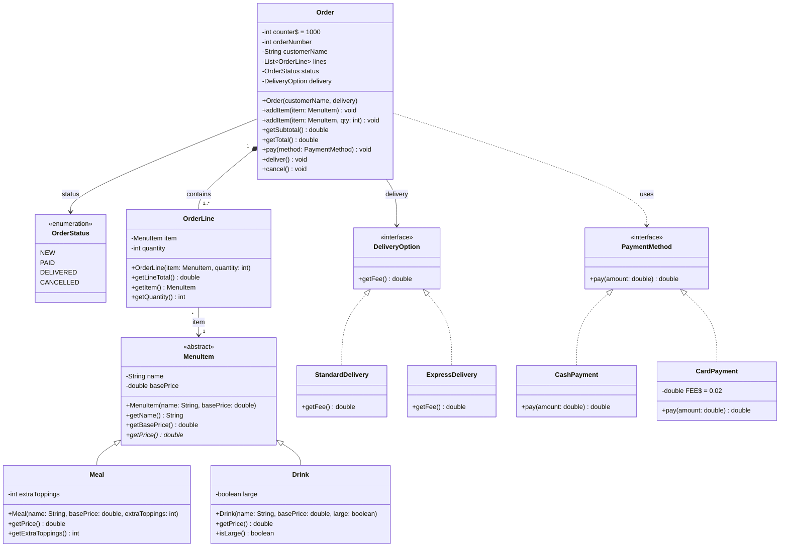

# Food Delivery System (Java) 🍔🍕🥤

An Object-Oriented restaurant order processing, billing, and delivery tracking system implemented in Java, exactly matching the provided UML Class Diagram specification.

---

## 📋 System Requirements & Design Overview

A restaurant requires a robust system to:
1. Receive customer orders with customizable menu items.
2. Calculate item prices, line totals, subtotals, and total bills.
3. Support flexible delivery options without modifying the `Order` class.
4. Process multiple payment methods with method-specific fees.
5. Track and enforce order lifecycles and business state constraints.

---

## 📐 UML Class Diagram



---

## 🏗️ Object-Oriented Principles Applied

1. **Encapsulation**:
   - All fields are `private` with public accessors and mutator business logic.
   - The order number sequence is encapsulated within `Order` using a private static counter (`counter = 1000`).

2. **Inheritance & Polymorphism**:
   - `MenuItem` is an `abstract` class defining the shared attributes (`name`, `basePrice`) and an abstract method `getPrice()`.
   - `Meal` and `Drink` provide polymorphic implementations of `getPrice()`:
     - `Meal`: `basePrice + (extraToppings * 1.5)`
     - `Drink`: `basePrice + (large ? 1.0 : 0.0)`

3. **Composition**:
   - `Order` has a composition relationship (`1` contains `1..*`) with `OrderLine`. `OrderLine` instances are managed and owned directly by `Order`.

4. **Strategy Pattern & Open-Closed Principle (OCP)**:
   - **Delivery**: The `DeliveryOption` interface decouples `Order` from concrete delivery types (`StandardDelivery` costs $2, `ExpressDelivery` costs $5). New delivery options (e.g. Drone delivery, VIP delivery) can be added without modifying the `Order` class.
   - **Payment**: The `PaymentMethod` interface decouples `Order` from payment mechanisms (`CashPayment` with 0% fee, `CardPayment` with 2% fee).

5. **State & Invariant Validation**:
   - Items can only be added while the order status is `NEW`.
   - Order transitions to `PAID` upon payment.
   - Only a `PAID` order can be delivered (`deliver()`).
   - Only a `NEW` order can be cancelled (`cancel()`).
   - Violations throw informative `IllegalStateException` instances.

---

## 🧮 Assignment Example Walkthrough

**Given:**
- 2 × Burger Meal (Base Price: $8.00, 1 extra topping @ $1.50)
- 1 × Large Juice (Base Price: $3.00, Large: +$1.00)
- Express Delivery ($5.00)
- Paid by Card (2% fee)

**Calculations:**
```text
Burger Unit Price = $8.00 + $1.50 = $9.50
Burger Line Total = $9.50 × 2     = $19.00

Juice Unit Price  = $3.00 + $1.00 = $4.00
Juice Line Total  = $4.00 × 1     = $4.00

Subtotal          = $19.00 + $4.00 = $23.00
Express Delivery  = $5.00
Order Total       = $23.00 + $5.00 = $28.00

Card Payment Fee  = 2%
Paid by Card      = $28.00 × 1.02  = $28.56
```

---

## 📂 Project Directory Structure

```text
FoodDeliverySystem-Java/
├── pom.xml                                      # Maven configuration
├── README.md                                    # Comprehensive documentation
├── .gitignore                                   # Git ignore rules
├── compile.bat                                  # 1-Click Windows compiler script
├── run.bat                                      # 1-Click Windows runner script
├── src/
│   ├── main/
│   │   └── java/
│   │       └── com/
│   │           └── fooddelivery/
│   │               ├── OrderStatus.java         # Enum: NEW, PAID, DELIVERED, CANCELLED
│   │               ├── MenuItem.java            # Abstract base class for items
│   │               ├── Meal.java                # Meal with extra toppings calculation
│   │               ├── Drink.java               # Drink with large surcharge calculation
│   │               ├── OrderLine.java           # Order line item and line total
│   │               ├── DeliveryOption.java      # Delivery strategy interface
│   │               ├── StandardDelivery.java    # Standard delivery ($2)
│   │               ├── ExpressDelivery.java     # Express delivery ($5)
│   │               ├── PaymentMethod.java       # Payment strategy interface
│   │               ├── CashPayment.java         # Cash payment (0% fee)
│   │               ├── CardPayment.java         # Card payment (2% fee)
│   │               ├── Order.java               # Core order entity with lifecycle rules
│   │               └── Main.java                # Full scenario demonstration
│   └── test/
│       └── java/
│           └── com/
│               └── fooddelivery/
│                   └── FoodDeliverySystemTest.java  # 30-case automated unit test suite
```

---

## 🚀 How to Compile and Run

### Option 1: Using 1-Click Batch Scripts (Windows)
1. Double-click `compile.bat` to compile all source files into `bin/`.
2. Double-click `run.bat` to execute `Main` and run the automated test suite.

### Option 2: Using Standard Java Commands (Terminal)
```bash
# Navigate to project root
cd FoodDeliverySystem-Java

# Compile all classes
javac -d bin src/main/java/com/fooddelivery/*.java src/test/java/com/fooddelivery/*.java

# Run Main demonstration
java -cp bin com.fooddelivery.Main

# Run automated test suite
java -cp bin com.fooddelivery.FoodDeliverySystemTest
```

### Option 3: Using Maven
```bash
# Compile and package
mvn clean package

# Run Main
mvn exec:java
```

---

## ✅ Automated Test Suite Verification

The automated test suite (`FoodDeliverySystemTest`) tests **30 distinct assertions**:
- [x] Automatic order number sequence (1001, 1002, 1003, ...)
- [x] Meal pricing formulas with 0, 1, and N toppings
- [x] Drink pricing formulas for regular and large sizes
- [x] Exact assignment example line totals, subtotal ($23.00), total ($28.00), and card amount ($28.56)
- [x] Delivery fees for Standard ($2.00) and Express ($5.00)
- [x] Payment fee calculations for Cash (0%) and Card (2%)
- [x] Complete lifecycle transitions: `NEW` ➔ `PAID` ➔ `DELIVERED`
- [x] Cancellation rule enforcement (only `NEW` orders can be cancelled)
- [x] Prevention of adding items to `PAID` or `CANCELLED` orders
- [x] Prevention of delivering an unpaid order
- [x] Prevention of cancelling a `PAID` or `DELIVERED` order
- [x] Prevention of paying an empty order
- [x] Extensibility test: adding custom delivery and payment strategies dynamically
