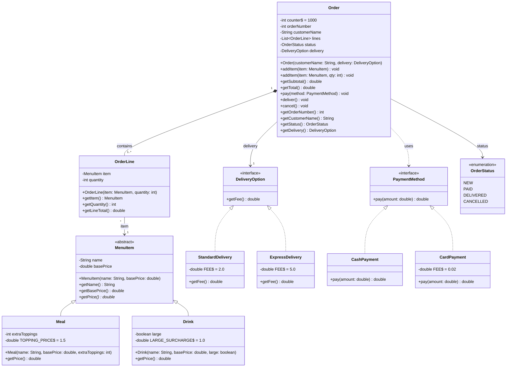

# Food Delivery System (Java)

A simple object-oriented restaurant order processing system implemented in Java.
Covers menu items, order management, delivery options, and payment methods.

## UML Class Diagram



> **Note on multiplicity:** The UML shows `1..*` OrderLines per Order. In code, a NEW order
> starts with an empty list while items are being added. Payment is rejected until at least
> one item exists, so a PAID/DELIVERED order always satisfies `1..*`.

**Supporting members beyond the simplified UML:** constructors for MenuItem, Meal, Drink,
and OrderLine; accessors `getItem()`, `getQuantity()` on OrderLine; accessors
`getOrderNumber()`, `getCustomerName()`, `getStatus()`, `getDelivery()` on Order;
static final pricing constants `TOPPING_PRICE`, `LARGE_SURCHARGE`, and delivery `FEE` fields.

## Pricing Rules

- **Meal:** basePrice + extraToppings × 1.5
- **Drink:** basePrice + 1.0 if large, otherwise basePrice
- **OrderLine total:** item.getPrice() × quantity
- **Standard delivery:** 2.0
- **Express delivery:** 5.0
- **Cash payment:** returns amount (no fee)
- **Card payment:** returns amount × 1.02

## Order Lifecycle

- Status starts as `NEW`.
- Items can only be added while `NEW`.
- `pay()` requires at least one item and status `NEW` → changes to `PAID`.
- `deliver()` requires status `PAID` → changes to `DELIVERED`.
- `cancel()` requires status `NEW` → changes to `CANCELLED`.

## How to Compile and Run

### Using batch scripts (Windows)

```
compile.bat
run.bat
```

### Using javac/java directly

```bash
javac -d bin src/main/java/com/fooddelivery/*.java
java -cp bin com.fooddelivery.Main
```

### Using Maven

```bash
mvn clean compile
mvn exec:java -Dexec.mainClass="com.fooddelivery.Main"
```

## Example Output

```
Burger Meal unit price: 9.5
Juice unit price: 4.0
Order #1001 created for Sarah Connor
Status: NEW
Subtotal: 23.0
Delivery fee: 5.0
Total: 28.0
Card amount: 28.56
Status after payment: PAID
Status after delivery: DELIVERED

--- Validation checks ---
Cannot add items: order is not NEW (current status: DELIVERED).
Cannot deliver: order is not PAID (current status: DELIVERED).
Cannot cancel: order is not NEW (current status: DELIVERED).
Cannot pay: order is not NEW (current status: DELIVERED).
Order #1002 status: NEW
Order #1002 status after cancel: CANCELLED
Cannot deliver: order is not PAID (current status: NEW).
Cannot pay: order has no items.
```
